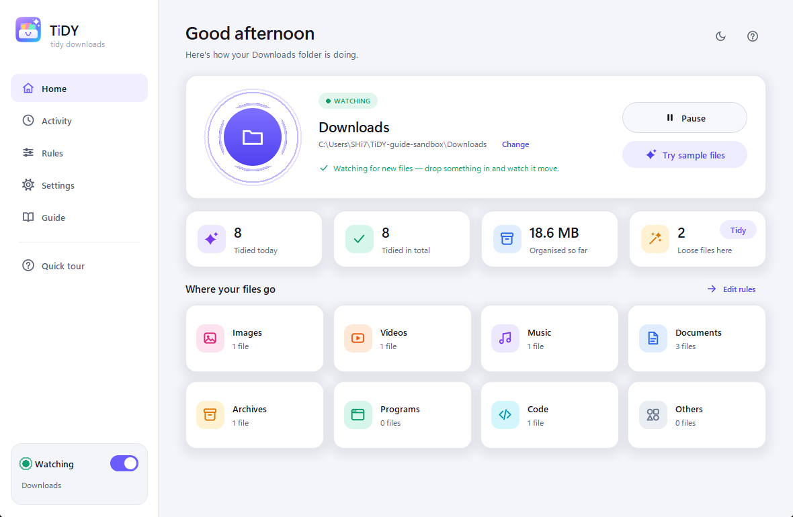
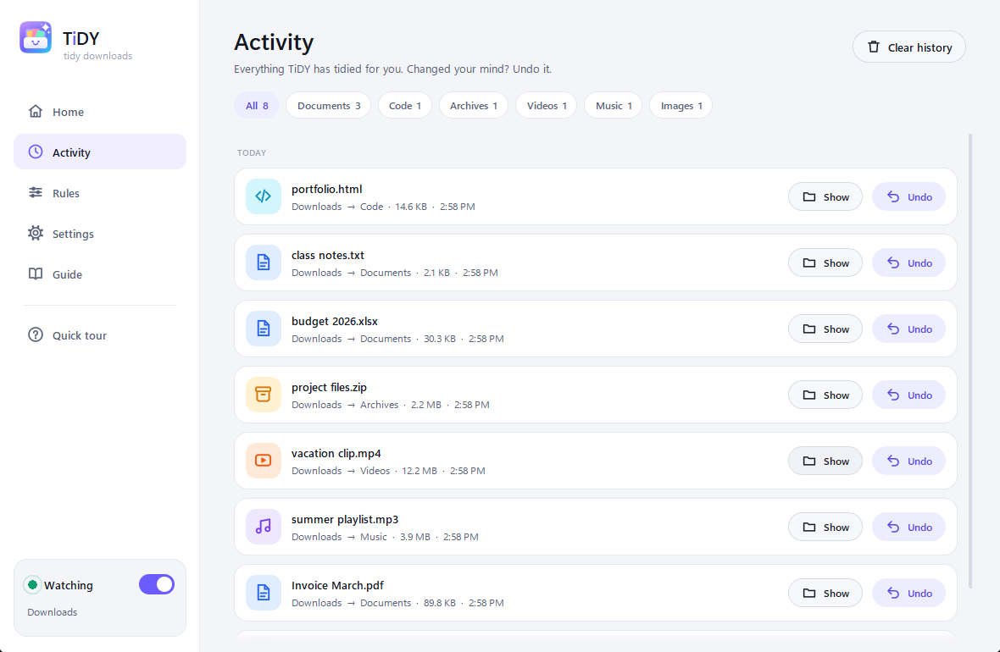
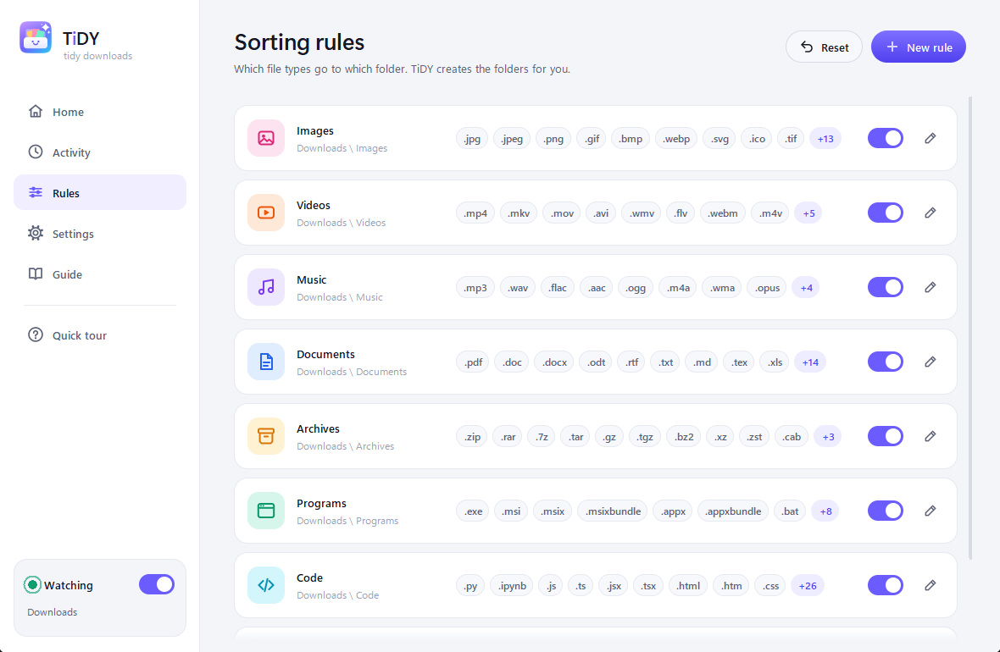
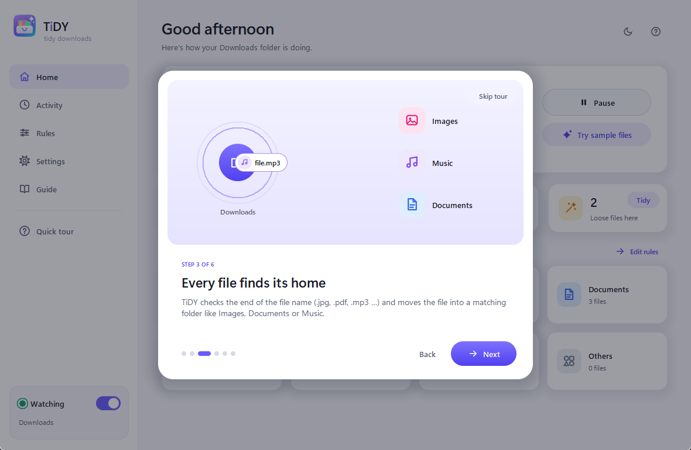
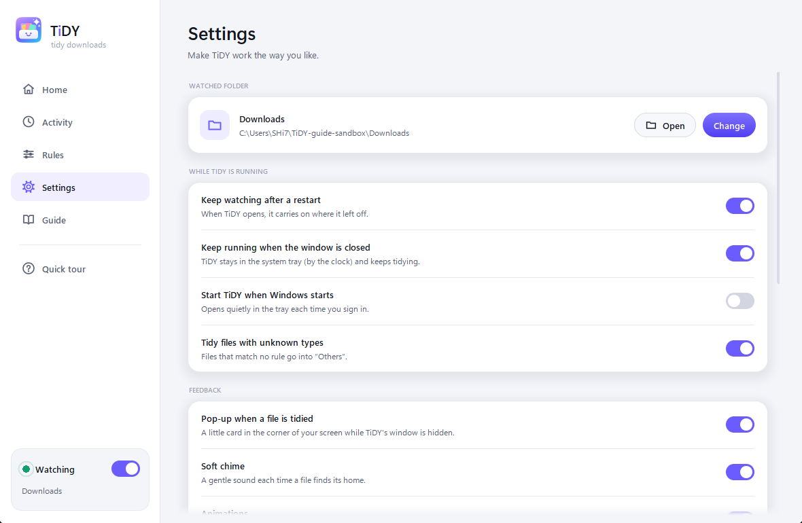

<p align="center">
  
</p>

<h1 align="center">TiDY</h1>

<p align="center"><b>Your Downloads folder, always tidy.</b><br>
A folder monitor and automatic file sorter for Windows, made with Python.</p>

<p align="center">
  
</p>

TiDY watches one folder (your **Downloads** folder by default). The moment a file is created, downloaded or dropped
there, Windows sends TiDY a change event, and TiDY moves the file into a sub-folder that matches its type:

| A new file like … | … is moved to |
|---|---|
| `holiday.jpg` | `Downloads\Images` |
| `report.pdf` | `Downloads\Documents` |
| `song.mp3` | `Downloads\Music` |
| `setup.exe` | `Downloads\Programs` |
| `photos.zip` | `Downloads\Archives` |

## Features

- **Real-time watching** with Windows' own change events (`ReadDirectoryChangesW`), so it uses no CPU while nothing happens
- **Safe with downloads**: waits until a download (`.crdownload`, `.part`, …) has completely finished
- **Never deletes or overwrites**: if a name is taken, it saves `photo (1).jpg`; every move can be **undone**
- **Editable rules**: 8 folders out of the box, plus your own rules, colours and icons
- **Activity history** with *Show in folder* and *Undo*
- **Runs in the background** in the system tray, with optional pop-ups, a soft chime and *Start with Windows*
- **Beautiful and simple**: animations, light and dark themes, an animated quick tour and a built-in user guide
- **100% offline** and **only Python**: a single file that uses nothing but Python's standard library

## Install it

TiDY needs **Windows 10 or 11** and **Python 3.8 or newer**. Nothing else to download.

1. If the computer doesn't have Python yet, install it from [python.org](https://www.python.org/downloads/windows/).
   If the installer shows **Add python.exe to PATH**, tick it.
2. Download TiDY: click the green **Code** button above, then **Download ZIP**, and unzip it.
   (Or download only [`TiDY.py`](TiDY.py).)
3. Double-click **`TiDY.py`**. TiDY opens straight away; it works even without installing.
4. In TiDY, go to **Settings → Help** and click **Install** next to *Install TiDY on this PC*.

That's it. TiDY now has an icon in the **Start menu** and on the **desktop**, and it appears in Windows
**Settings → Apps**. You can delete the downloaded files. Installing needs **no administrator rights**. TiDY is copied
to `%LOCALAPPDATA%\Programs\TiDY`.

Prefer the command line? In the folder that contains `TiDY.py`:

```
py TiDY.py --install
```

**To update:** open the newer `TiDY.py` and click **Update** in Settings → Help (or run `py TiDY.py --install` again).

**To uninstall:** Windows **Settings → Apps → Installed apps → TiDY → Uninstall**, or **Uninstall** in TiDY's own
Settings. TiDY asks whether to keep your settings. Your own files are never touched.

## Use it

1. Press **Start tidying** on the Home page.
2. Download, save or drop a file into your Downloads folder.
3. Watch it fly into its folder. Changed your mind? Click **Undo**.

New to TiDY? The [**User Guide**](docs/TiDY%20User%20Guide.docx) (Word, 16 pages) explains everything step by step.
The same guide is built into the app: click **Guide** in the sidebar.

## Screenshots

| Activity | Rules |
|---|---|
|  |  |
| **Quick tour** | **Settings** |
|  |  |

## Command-line options

| Option | What it does |
|---|---|
| *(none)* | Open TiDY |
| `--install` | Install TiDY on this PC (Start menu, desktop shortcut, Settings → Apps) |
| `--uninstall` | Remove TiDY from this PC |
| `--background` | Start hidden in the system tray and start watching (used by *Start with Windows*) |
| `--export-logo FILE.png` | Save the TiDY logo as a 512 × 512 picture |

## How it works

- **Watching:** a background thread calls `ReadDirectoryChangesW` through `ctypes`, so Windows wakes TiDY the instant
  something changes in the folder. If that is not available, TiDY falls back to comparing folder snapshots.
- **Deciding when a file is finished:** a file is only moved once no new events arrive for a moment, its size and
  modification time stay the same, no partial download sits next to it, and Windows allows the move (nobody is still
  writing it). If the file is still in use, TiDY retries a little later.
- **Moving:** `os.rename` into `<folder>\<rule folder>`, choosing `name (1).ext` and so on when a name is taken.
- **The interface** is drawn on a single Tkinter canvas. Anti-aliased shapes, icons and the logo are drawn by a tiny
  built-in renderer (signed-distance fields → PNG), because Tkinter can't anti-alias shapes by itself.
- **Settings and history** are stored in `%APPDATA%\TiDY` (`settings.json`, `history.json`). Nothing ever leaves the
  computer.

## Project files

```
TiDY.py                      the whole app (Python standard library only)
docs/TiDY User Guide.docx    the full user guide
docs/images/                 logo and screenshots
```
